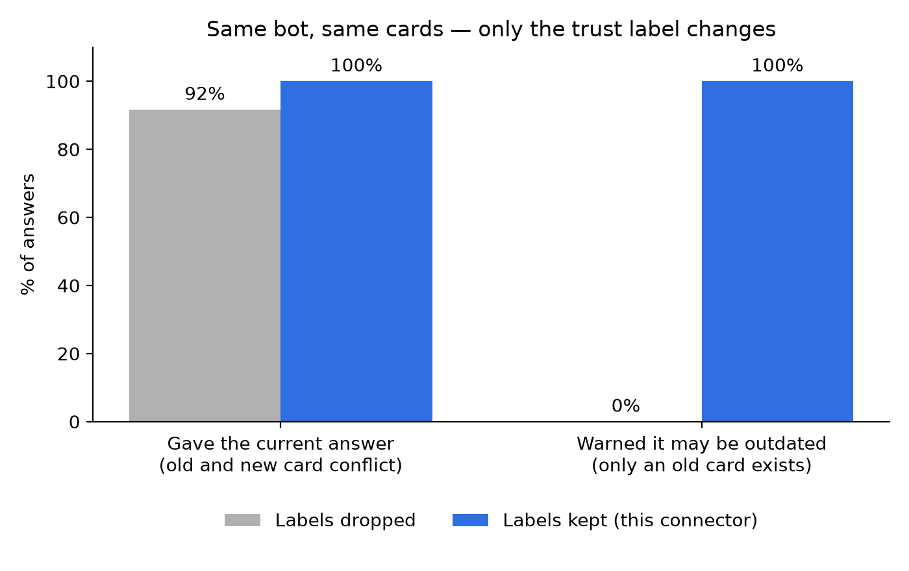
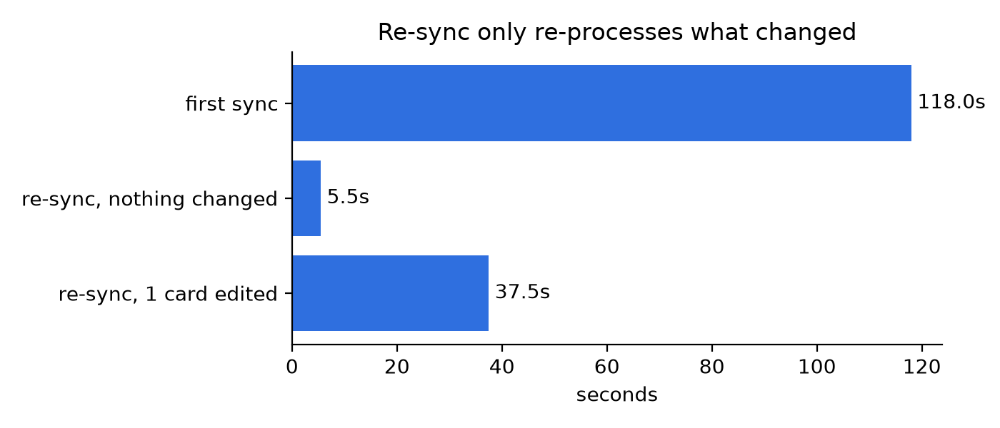

So here's the thing.. Every team has a wiki, but half of it is old. And personally based on what I've seen, it happens all the time, so we need a solution for that. In our case, Guru tries to fix that. Every card has a trust label: **Trusted**, **Stale**, or **Needs verification**. An expert re-checks cards on a schedule.

But when you plug a wiki into an AI agent, that label is lost. The bot reads an outdated card and answers like it's fact....

For Mergetober I built a Guru connector for [Cognee](https://github.com/topoteretes/cognee) that keeps the label.

## The use case: a support bot that doesn't lie with confidence

I like to think of a support team with 300 Guru cards: refund rules, pricing, setup guides.

A customer asks: "Can I get a refund after 30 days?"

- The refund card is **Trusted** → the bot answers.
- The refund card **Needs verification** (policy changed, nobody updated it) → the bot still answers, but says: "This info may be outdated. Please confirm with the team."

Same bot, same data, but yeah, it just knows which answers to trust.

## Ok but does it actually work?

Honestly I wasn't sure. So I tested it.

I made 20 fake Guru cards for a made-up company. Some topics have an old card (wrong, needs verification) and a newer one (right, trusted). Some only have the old card, nothing newer.

Then I loaded them into Cognee twice. Once with the trust labels thrown away, once with them kept. Same 12 questions, asked 3 times each. Same bot, same prompt. I used DeepSeek V4.1 Flash because it's cheap.



First part surprised me a bit. When an old and a new card disagree, the bot picks the right one most of the time anyway. 92% without labels, 100% with. Nice, but not huge.

The second part is the real thing. When **only the old card exists**, the bot without labels warned the user **0 times out of 12**. Zero. It just said the old stuff like it's fact. With labels it warned **12 out of 12**.

Here's a real answer for "Do nonprofits get a discount?":

> **Without labels:** Yes — registered nonprofits get 50% off any plan.

> **With labels:** Yes — registered nonprofits get 50% off any plan. Note that this entry is marked NEEDS_VERIFICATION (EXPIRED, last verified 2024-03-01), so the discount may be outdated.

Same info. But the second one doesn't let a customer walk away thinking it's 100% true.

Also tried asking "list every card that needs verification". It found 11 out of 12. So you get a cleanup to-do list for free, which is kinda cool.

And syncing again is fast, because only changed cards get processed again:



The whole thing cost me about $0.30. Code and raw results are [here](https://github.com/modaribrahim/blog/tree/main/guru-experiment) if you want to check.

## What the connector does

I will mention here and try to be brief:

- Pulls Guru cards into Cognee memory.
- Puts the trust label in each card's text, so the agent sees it.
- Keeps collection and folder names, so context isn't lost.
- Card deleted in Guru? Gone from memory on the next sync.
- Only changed cards are processed again. Saves LLM cost.
- If Guru's API fails mid-sync, it stops. Nothing gets wrongly deleted.

## How to use it

The best way to explain it actually is by coding it:

```python
import cognee
from cognee_community_connector_guru import guru_source

source = guru_source(email="you@company.com", token="...")
await cognee.remember(source, dataset_name="guru")

answer = await cognee.search(
    query_text="Can I get a refund after 30 days?",
    datasets=["guru"],
)
```

Only want trusted cards? `guru_source(verification_state="trusted")`.
One folder? `guru_source(folder_id="...")`.

## Testing

The connector has 49 tests. I ran them on a fresh Ubuntu 24.04 VM with Python 3.11. The Guru API is mocked, so anyone can run them without an account...

## Links

- PR: https://github.com/topoteretes/cognee-community/pull/238
- Issue: https://github.com/topoteretes/cognee/issues/4721
- Mergetober: https://www.wemakedevs.org/hackathons/mergetober
